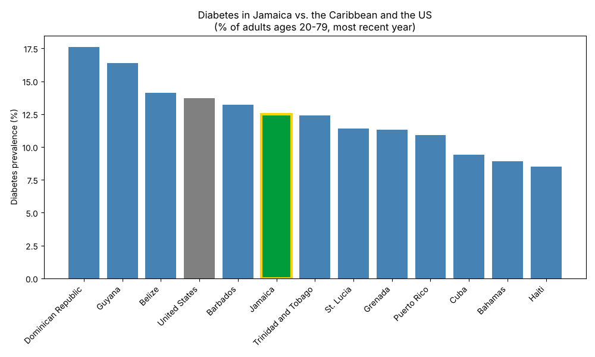

# PS4: Diabetes in Jamaica vs. the Caribbean (World Bank API)

**By Tobianna Clarke (tclarke367)**, BSC 4452 Problem Set 4. I did this one solo.

## Why I picked this

My grandma has type 2 diabetes, and I'm from Jamaica, so I wanted to see how common diabetes is back home compared to the rest of the Caribbean and the US. I'm also pre-med, so health data is the kind of thing I actually want to get used to working with.

## What API I used

The **World Bank Indicators API** (free, no sign-up or key needed):
https://api.worldbank.org/v2/

The indicator is `SH.STA.DIAB.ZS`: **diabetes prevalence (% of population ages 20 to 79)**. This counts all diabetes, but most adult cases are type 2.

## What the script does

`diabetes_api.py`:

1. Asks the API for diabetes data for 12 Caribbean countries plus the US
2. Cleans it up. Most years are empty because they only measure every few years, so it keeps just the years that have numbers
3. Prints a ranked table of each country's most recent year, the Caribbean average, how Jamaica compares, and how Jamaica changed over time
4. Makes a bar chart (`diabetes_caribbean.png`) with Jamaica in flag colors (green with a gold outline) and the US in gray

So it does more than print the raw JSON. It picks out one number per country, ranks them, compares them, and graphs them.

## How to run it

```
pip install requests matplotlib
python diabetes_api.py
```

The printed output from my run is saved in `output.txt`.

## What I found



- Jamaica is at **12.5%** (2024), right around the Caribbean average of **12.2%**
- The **US (13.7%)** is actually higher than Jamaica
- Jamaica went **down** from 15.7% in 2011 to 12.5% in 2024, which surprised me. A lot of other countries (like the Dominican Republic, 8.1% to 17.6%) went way up
- Highest: Dominican Republic (17.6%). Lowest: Haiti (8.5%)

**Heads up:** some countries only have 2 or 3 years of data total, so "over time" is really just a couple of points. A lower number could also partly come from changes in how the surveys were done, not just fewer people having diabetes.
